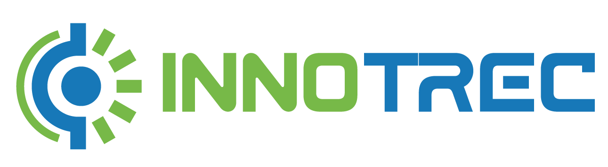

<p align="center">
  
</p>

<p align="center">
  <a href="https://gitlab.up.pt/inno-trec/inno-trec-web-template/-/pipelines?ref=main"></a>
  <a href="https://gitlab.up.pt/inno-trec/inno-trec-web-template/-/releases"></a>
  <a href="https://glpages.up.pt/inno-trec/inno-trec-web-template/"></a>
  <a href=".nvmrc"></a>
  <a href="LICENSE"></a>
</p>

A starting point for INNO-TREC web tools. It packages the INNO-TREC design system (colors, type, components) with a working React app, so a team can build a new tool by changing pages instead of setting up styling and navigation from scratch.

The repository holds the template and example apps only. Each team builds its own solution from it.

## Start in two minutes

```sh
npm install
npm run dev          # serves the starter at http://localhost:5173
```

You get a minimal tool: a top bar, side navigation, the EU funding footer, the account screens (sign in, ask for an account, invitation, password reset, your account), user management, and one example page to replace with your own. Sign in as `ana.ribeiro@example.org` with the password `sample-password`. Edit `apps/web-starter/src/pages/` and the browser updates.

Two example apps hold complete pages to copy:

```sh
npm run dev:demo     # template demo: energy overview with charts, PV performance, data checks, alerts, assets
npm run dev:credits  # credit screens (ECMS): ledger overview, wallets, send flow, member wallet
```

The documentation is also a website with the template demo as a live demo and every component running in the component guide (GitLab Pages). Preview it with `npm run docs:dev`.

The template serves the INNO-TREC web tools: energy monitoring (consumption, PV, storage), PV yield and performance, asset maintenance, and the energy credit system.

To build a tool of your own, read [Getting started](docs/getting-started.md).

## What is inside

| Path | What it is |
| --- | --- |
| `apps/web-starter/` | The starter app: Vite, React 19, TypeScript, Tailwind. The page frame, account screens, user management and one example page. Copy it to start a tool. |
| `apps/template-demo/` | Example pages for monitoring, PV performance and maintenance tools, with ECharts charts on synthetic data. The live demo on the website. |
| `apps/credits-example/` | Example pages for energy credit tools (ECMS): ledger overview, wallets, send flow, member wallet. |
| `packages/ui-web/` | The design system components for React on the web, with their styles and logos. Generated. |
| `packages/tokens/` | The design tokens as a Tailwind preset, CSS variables and JavaScript constants. Generated. |
| `docs/` | The documentation, also published as a website (VitePress, `docs/.vitepress/`). Start with the table below. |
| `scripts/` | `sync-design-system.mjs` copies the design system into `packages/` and `docs/reference/`. `export-tokens.mjs` copies the tokens into another project. `build-pages.mjs` builds the website with the demo. |
| `design-system.lock.json` | Which version of the design system this copy came from, and a hash of every generated file. |
| `CHANGELOG.md` | What changed in each version of the template. |

The two packages are generated from the design system repository. Do not edit them by hand: change the design system, then run `npm run sync:ds`.

## Documentation

| Read this | When you want to |
| --- | --- |
| [Getting started](docs/getting-started.md) | Create a tool, add a page, connect your backend, deploy |
| [Page patterns](docs/page-patterns.md) | Build monitoring, performance, data checks, alerts, lists with detail, step flows, forms and account screens the way the design system expects |
| [Design rules](docs/design-rules.md) | Check what the design system requires before you design a screen |
| [Components](docs/reference/components.md) | Look up when to use each of the 40 components and what it needs |
| [Tokens and Tailwind](docs/tokens-and-tailwind.md) | Use the right class names, colors and spacing |
| [Architecture](docs/architecture.md) | Understand how the repository fits together |
| [Troubleshooting](docs/troubleshooting.md) | Fix a problem someone has already hit |
| [Contributing](docs/contributing.md) | Change the template itself |
| [Mobile](docs/mobile.md) | See how the mobile app shares tokens with the web tools |

## Commands

| Command | What it does |
| --- | --- |
| `npm run dev` | Starts the starter app with hot reload |
| `npm run dev:credits` | Starts the credits example |
| `npm run typecheck` | Checks types in every workspace |
| `npm run build` | Type checks and builds every app into its own `dist/` folder |
| `npm test` | Runs the browser smoke tests of every app at 1440px and 400px wide |
| `npm run check:generated` | Fails if a generated file was edited by hand |
| `npm run docs:dev` | Previews the documentation website |
| `npm run pages:build` | Builds the website and the demo into `docs/.vitepress/dist/` |
| `npm run tokens` | Rebuilds the tokens package from `tokens.json` |
| `npm run sync:ds` | Copies the latest design system into this repository |
| `npm run export:tokens -- <folder>` | Copies the tokens into another project, such as the mobile app |

## What this template does not include

- **A mobile app.** The mobile app lives elsewhere and shares only the tokens. See [Mobile](docs/mobile.md).
- **A real backend or identity provider.** The account screens, the session and the data run on a sample backend in `src/data/`. Replace it with your backend; each system owns its data API.
- **Unit tests.** The starter has browser smoke tests (`npm test`), not unit tests. Add a unit test runner when your tool has logic of its own.
- **Deployment setup for your tool.** `npm run build` produces static files. Where they go is your team's choice. (The template publishes only its own documentation site.)

## Versions this was verified with

Node 24 (LTS) and 26, npm 11, React 19.3, Vite 8, TypeScript 7, Tailwind 3.4, React Router 8, Apache ECharts 6.1. The design system components were written for React 18 and render correctly on 19 in the starter. Tailwind stays on 3.4 because the mobile app's NativeWind 4 needs Tailwind 3, and web and mobile share the preset.
